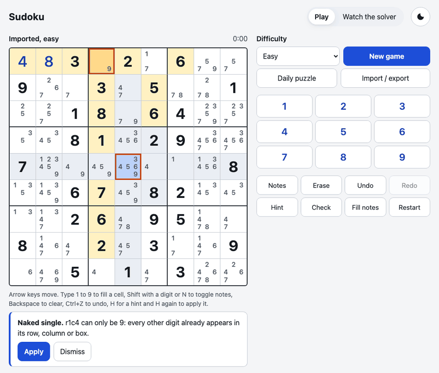
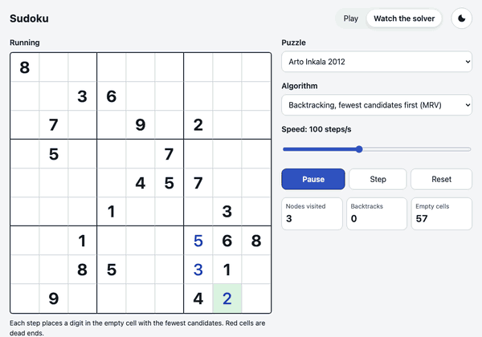
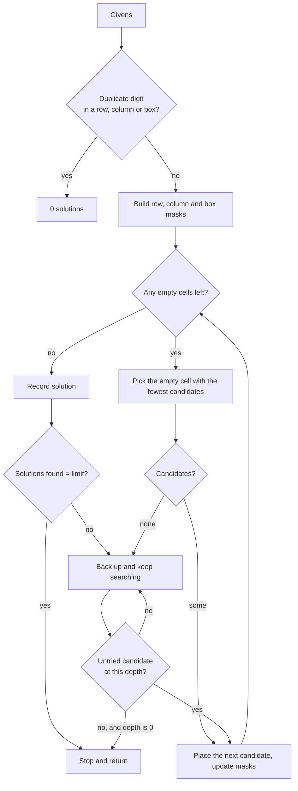
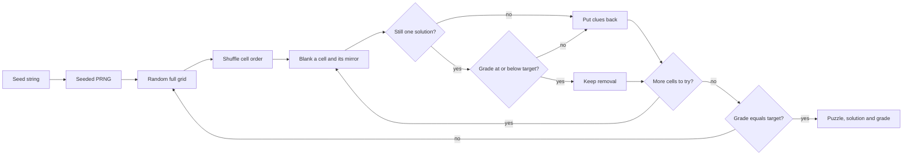
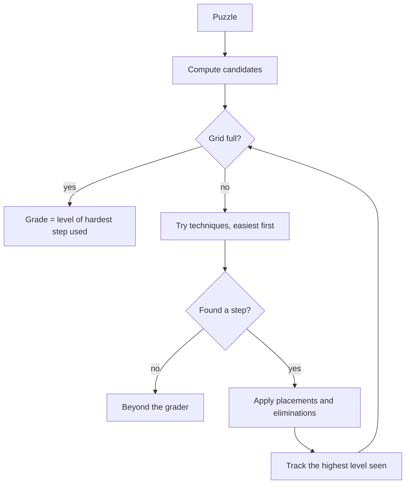

# Sudoku

A Sudoku you can actually play, backed by an engine that generates graded puzzles, explains every hint by technique name, and lets you watch three different solvers work through a board step by step.





**Live demo:** https://shashank11yadav.github.io/Sudoku/

## Features

- Four difficulty levels, each graded by the hardest human technique a puzzle needs, plus a daily puzzle that is the same for everyone on a given date.
- Input by mouse, touch keypad or keyboard. The whole game works without a mouse.
- Pencil notes, "fill notes", undo and redo, restart, and a check that marks wrong digits.
- Conflict highlighting plus highlighting of the selected cell's row, column, box and matching digits.
- Hints that name the technique and explain it, for example "Pointing pair. In box 4, 7 can only go in row 5 (r5c1 and r5c2), so remove 7 from r5c7 and r5c9." Press H to see a hint and H again to apply it.
- Import any 81-character puzzle. It is checked for bad characters, duplicate givens, no solution and multiple solutions, with a specific message for each.
- Export the puzzle or your current board as a string.
- Progress, notes and the timer survive a reload (stored locally, validated on load).
- Light and dark themes, reduced motion support, and a layout that works down to 375px wide.
- **Watch the solver:** replay naive backtracking, MRV backtracking or the human-technique solver on the current game or on well-known hard puzzles, with a speed slider from 1 to 100,000 steps per second and live counters for nodes visited and backtracks.

## How the engine works

Everything below lives in `src/engine/`, which has no DOM dependencies. It is type-checked on its own against a config with no DOM types, so nothing browser-specific can creep in. The same code runs in the Web Worker, in the visualizer, in Vitest and in the benchmark.

### Representation

A grid is a `Uint8Array(81)`, with 0 for empty. Candidates are 9-bit masks where bit `d - 1` means digit `d`. The backtracking solver keeps one mask per row, column and box, so the candidates for a cell are `~(row | col | box) & 0x1FF`: one OR and one NOT, with no scanning. Popcounts and digit lists for all 512 masks are precomputed.

### Solvers

There are three, sharing the same input and output types.

- **Naive backtracking** fills the first empty cell in reading order. It is here as the baseline the original project used.
- **MRV backtracking** (minimum remaining values) always branches on the empty cell with the fewest candidates. A cell with zero candidates ends the branch immediately, and a cell with one is filled without branching.
- **Dancing Links** is Knuth's Algorithm X over the exact cover matrix: 324 constraint columns (cell filled, digit once per row, column and box) and 729 candidate rows. Links are stored in flat `Int32Array`s, and it always branches on the column with the fewest remaining rows.

Every solver takes a solution limit and stops as soon as it is reached. `solve` uses a limit of 1 and `countSolutions` uses 2, which is all a uniqueness check needs. The original code had no early exit and could hang the tab on sparse boards.



### Generator

1. Build a random complete grid: MRV backtracking on an empty board with the digit order shuffled by a seeded PRNG (Mulberry32, seeded from a string with FNV-1a). The same seed always gives the same puzzle, which is how the daily puzzle works.
2. Visit the 81 cells in random order and try to blank each one together with its 180-degree mirror.
3. Keep a removal only if the puzzle still has exactly one solution **and** the technique solver can still finish it without needing anything above the target level. Otherwise put the clues back.
4. Stop removing at a floor of givens per level (36 for easy, 30 for medium), so easy puzzles feel easy and not just technically simple.
5. Grade the result. If its hardest technique is exactly the target level, return it. If not, start again from a new full grid.

Step 3 is the important one. Without it, carving tends to overshoot into puzzles that need techniques the hint system cannot explain. With it, every generated puzzle is solvable by the techniques the app knows, so a hint is always available.



### Difficulty grading and hints

The technique solver keeps a candidate mask for every empty cell and tries these patterns in order, cheapest first. Each finder returns a `Step` with the placements, the eliminations, the cells that form the pattern and a sentence explaining it.

| Level | Techniques |
|---|---|
| Easy | Full house, naked single, hidden single |
| Medium | Pointing pair, claiming pair, naked pair, hidden pair |
| Hard | Naked triple, hidden triple, X-Wing |
| Expert | Swordfish, XY-Wing |

A puzzle's grade is the level of the hardest technique used along the way. If the solver gets stuck, the puzzle is "beyond the grader". That happens with imports like Easter Monster, which need chains or trial and error.

A hint runs the same solver from the player's current board. Wrong digits are reported first, since logic built on a wrong digit means nothing. If no technique applies (only possible with imported puzzles), the hint reveals the most constrained cell instead.



## Benchmarks

Measured with `npm run bench` on an Apple M4 (macOS, Node 26.8.1). Solve times are medians of repeated runs. Nodes means digit placements tried for backtracking and candidate rows chosen for DLX, so the counts are comparable. The uniqueness column is the time to prove there is no second solution.

| Puzzle | Givens | Naive | MRV | DLX | Naive nodes | MRV nodes | DLX nodes | DLX uniqueness check |
|---|---|---|---|---|---|---|---|---|
| Project Euler 96, grid 01 (easy) | 32 | 15 µs | 22 µs | 90 µs | 200 | 49 | 49 | 68 µs |
| 17-clue puzzle (Royle) | 17 | 560 ms | 0.43 ms | 36 µs | 26,590,293 | 4,812 | 64 | 35 µs |
| AI Escargot | 23 | 0.18 ms | 13 µs | 43 µs | 8,969 | 160 | 173 | 0.25 ms |
| Arto Inkala (2012) | 21 | 1.11 ms | 0.97 ms | 0.37 ms | 49,558 | 13,417 | 2,080 | 0.65 ms |
| Easter Monster | 21 | 5.55 ms | 0.41 ms | 0.55 ms | 262,014 | 5,693 | 3,823 | 1.22 ms |

| Difficulty | Median | p95 | Max | Full grids tried (avg) | Givens (avg) | Grade matched |
|---|---|---|---|---|---|---|
| Easy | 0.60 ms | 1.39 ms | 3.29 ms | 1.0 | 36.0 | 20/20 |
| Medium | 7.17 ms | 37 ms | 125 ms | 24.0 | 30.2 | 20/20 |
| Hard | 83 ms | 287 ms | 292 ms | 98.7 | 27.4 | 20/20 |
| Expert | 8.81 ms | 77 ms | 96 ms | 16.6 | 27.6 | 20/20 |

What the numbers say:

- The "world's hardest" puzzles are hard for people, not for search. MRV and DLX finish all of them in about a millisecond.
- The 17-clue puzzle is the real stress test for naive search: its top rows are almost empty, so reading-order backtracking makes 26.6 million placements. MRV needs 4,812 and DLX needs 64.
- DLX visits the fewest nodes almost everywhere, but each node costs more, so MRV is faster on easy boards. The generator uses MRV because it needs randomized digit order; DLX is kept as an independent cross-check in the tests.
- Hard is the slowest level to generate because puzzles whose hardest step is a triple or an X-Wing are rare. Expert is faster because anything up to Swordfish or XY-Wing qualifies.

## Design decisions

- **Vanilla TypeScript, no UI framework.** The UI is one 81-cell grid and a dozen controls. `GridView` builds the DOM once and patches only cells whose state changed, so a framework's diffing would add bytes without saving work. The whole app ships 17.2 KB of gzipped JavaScript (12.0 KB main, 5.2 KB worker) with zero runtime dependencies.
- **Engine as a pure module.** No DOM types, enforced by a separate `tsconfig.engine.json` and a lint rule. That keeps it testable in Node and usable in the worker.
- **A worker for generation, the main thread for the visualizer.** Generating a hard puzzle can take a few hundred milliseconds, so it runs in a Web Worker behind a small promise-based client. The visualizer instead advances a resumable, explicit-stack version of the search a bounded number of steps per animation frame. That keeps it pausable and steppable without precomputing millions of events, and it cannot block input because each frame's work is capped.
- **Strict typing where it pays.** `strict`, `exactOptionalPropertyTypes`, `noImplicitOverride`, `verbatimModuleSyntax` and type-aware `typescript-eslint` (`strictTypeChecked`). `noUncheckedIndexedAccess` is off because the engine indexes fixed-size typed arrays with indices that are in range by construction, and the flag would put a `!` on almost every line of the hot loops.
- **TypeScript 6.0.3, not 7.0.** TypeScript 7.0.2 is the latest release, but typescript-eslint 8.71.2 supports TypeScript below 6.1, and type-aware linting was worth more here than the newer compiler.
- **CSP only in the build.** The Vite dev server injects styles inline for hot reload, so the Content Security Policy meta tag is added by a small build-only plugin. The end-to-end tests run against the production build, so a CSP violation fails the suite.
- **Saved games are untrusted input.** Anything read from `localStorage` is checked (format, ranges, givens agree with the solution, solution is valid) before it becomes a game.
- **Hints from the current board, not a stored solve path.** That way a hint is always relevant to what the player sees, even after they have taken a different route.

## Running locally

Requires Node 22.12 or newer (CI uses Node 24).

```sh
git clone https://github.com/shashank11yadav/Sudoku.git
cd Sudoku
npm ci
npm run dev          # http://localhost:5400/Sudoku/
```

Other scripts:

```sh
npm test             # Vitest: engine and game model
npm run test:e2e     # Playwright against the production build (first run: npx playwright install chromium)
npm run lint         # ESLint with type-aware rules
npm run typecheck    # app config plus the DOM-free engine config
npm run build        # typecheck, then build to dist/
npm run size         # gzipped bundle sizes, fails above 60 KB of JS
npm run bench        # prints the benchmark tables above
```

### What the tests cover

- Every solver against known puzzles, including Inkala 2012, AI Escargot and Easter Monster, with backtracking and DLX required to agree.
- Uniqueness: a multi-solution puzzle, an empty grid, consistent but unsolvable givens, and conflicting givens.
- Parsing: lengths, characters, whitespace, oversized input and duplicate givens, each with its exact message.
- Technique finders on hand-built candidate patterns (pointing, claiming, pairs, triples, X-Wing, Swordfish, XY-Wing).
- Soundness: every step the technique solver takes on 29 boards is checked against the known solution. Placed digits must be right and eliminations must never remove the true digit.
- Generated puzzles for every level: one solution by both solvers, grade matches, symmetry holds, same seed gives the same puzzle.
- The game model: undo and redo, peer note cleanup, and rejection of tampered save data.
- End to end on desktop and a 375px touch viewport: a full game played by keyboard with a conflict, undo, redo, notes, a hint and the win dialog; keypad play; import errors; reload restore; the visualizer; and axe accessibility scans in both themes.

## Project structure

```
src/
  engine/          pure TypeScript, no DOM
    board.ts       geometry, units, peers, bitmask tables
    parse.ts       puzzle string parsing and givens validation
    backtrack.ts   naive and MRV backtracking, the step-by-step stepper
    dlx.ts         Dancing Links (Algorithm X)
    techniques.ts  human techniques and the logical solver
    generator.ts   grading and puzzle generation
    hint.ts        next-step hints from a player's board
    random.ts      seeded PRNG and shuffle
  game/            game state, undo history, save validation, daily seed
  worker/          Web Worker and its typed message protocol
  ui/              grid view, play controller, visualizer, theme, tabs
tests/             Vitest suites and reference puzzles
e2e/               Playwright tests
bench/             benchmark script
scripts/           bundle size check and README media capture
docs/              screenshot and GIF used in this README
```

## Limitations and next steps

- The grader knows twelve techniques. Puzzles that need coloring, chains or uniqueness arguments are reported as beyond the grader, and the generator never produces them, so "Expert" here tops out at Swordfish and XY-Wing. Adding simple coloring, XYZ-Wing and X-Chains is the next step.
- Hard puzzles take up to about 0.3 seconds to generate because exact grade matches are rare at that level. Caching a few pre-generated puzzles per level in the worker would hide that.
- The daily puzzle follows the player's local date, so two people in different time zones can see different puzzles for a few hours around midnight.
- The CSP is set by a meta tag because GitHub Pages does not allow custom headers. That means no `frame-ancestors` protection.
- Possible additions: offline support as a PWA, share links that carry the puzzle in the URL fragment, and solve statistics.

## Credits

- Dancing Links and Algorithm X: Donald E. Knuth, "Dancing Links" (2000).
- Mulberry32 PRNG: Tommy Ettinger. FNV-1a hash: Glenn Fowler, Landon Curt Noll and Kiem-Phong Vo.
- Technique names follow the conventions used by the Sudoku community, for example in HoDoKu and on Sudopedia.
- Reference puzzles: grid 01 from Project Euler problem 96; a 17-clue puzzle from Gordon Royle's collection; Arto Inkala's 2012 puzzle and AI Escargot; Easter Monster as posted on the Sudoku Players' Forum; and the multi-solution "hard1" grid from Peter Norvig's essay on solving Sudoku.
- Accessibility checks use axe-core through `@axe-core/playwright`.

## License

MIT. See [LICENSE](LICENSE).
